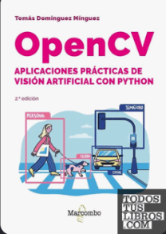
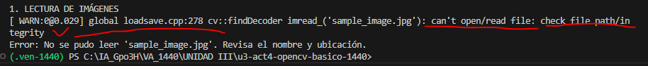
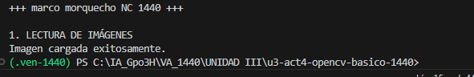
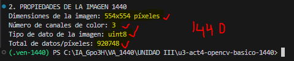
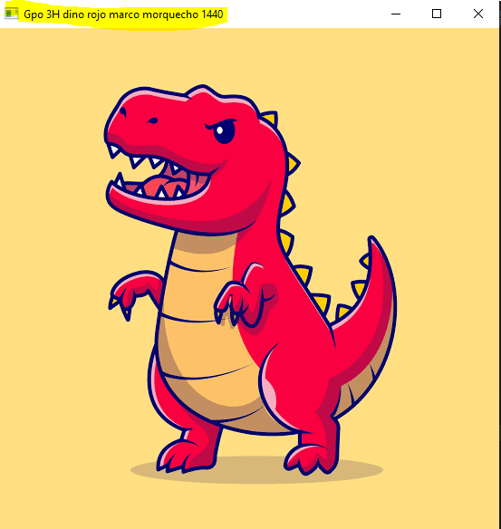
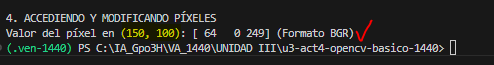
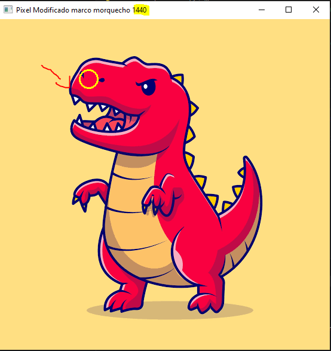

## operacion basica con open cv
## marco morquecho NC 1440

# 1. LECTURA DE LA IMAGEN DESDE LA CARPETA
### cuando no puede cargar la imagen 

## cuando puede leer la imagen

# 2. PROPIEDADES DE LA IMAGEN

# mostrando imagen original

## en la terminal 

# 4. ACCESO Y MODIFICACIÓN DE PÍXELES INDIVIDUALES
